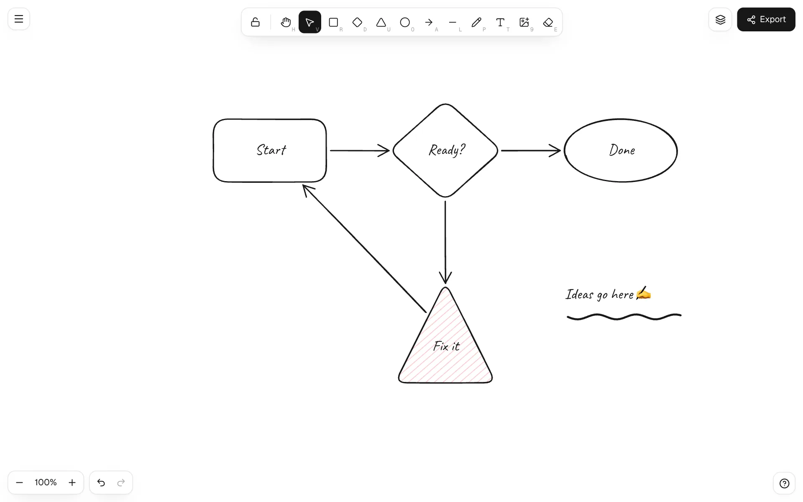
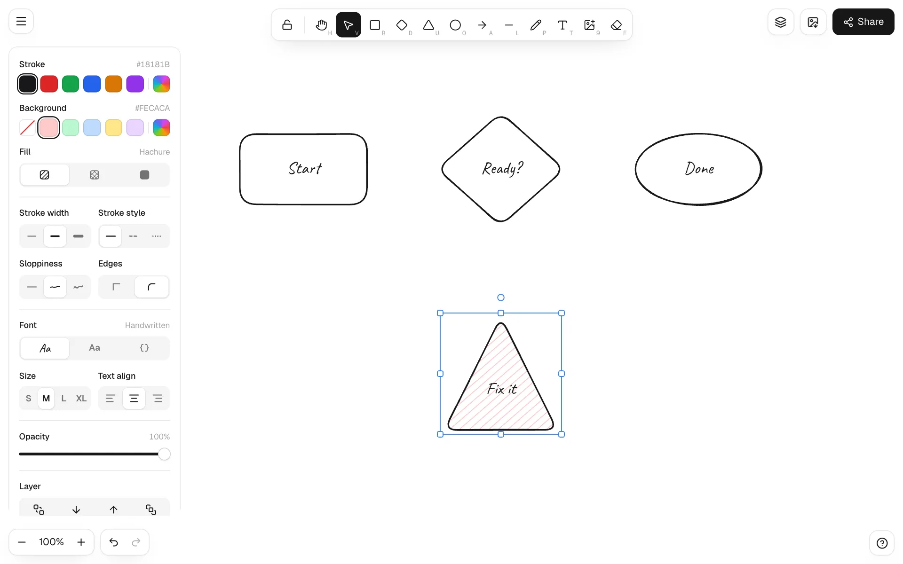
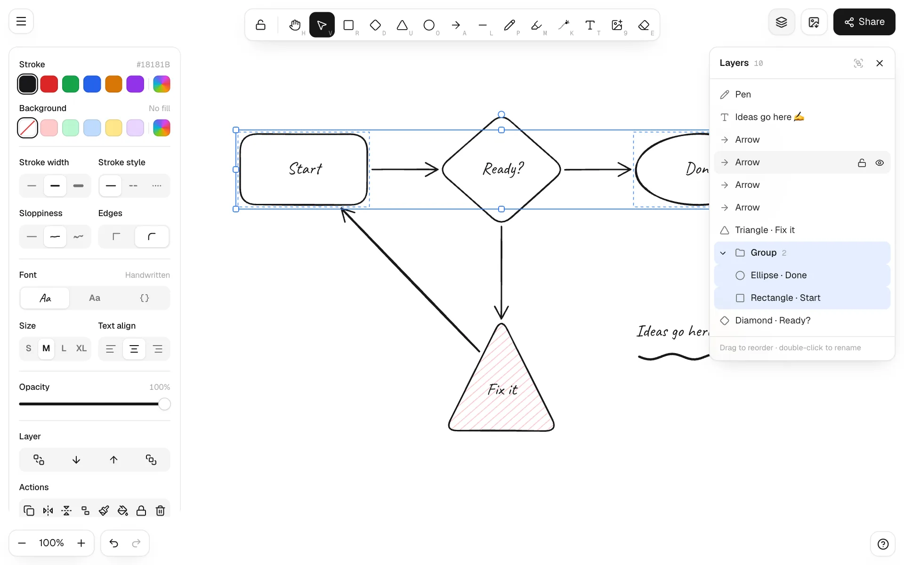
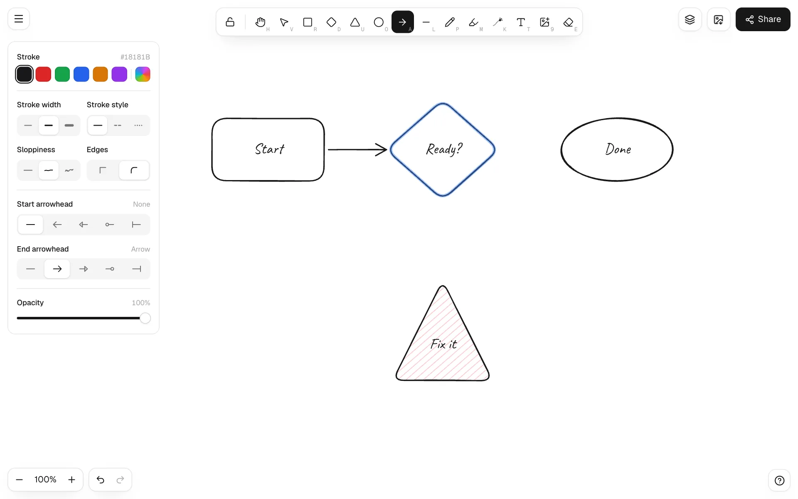
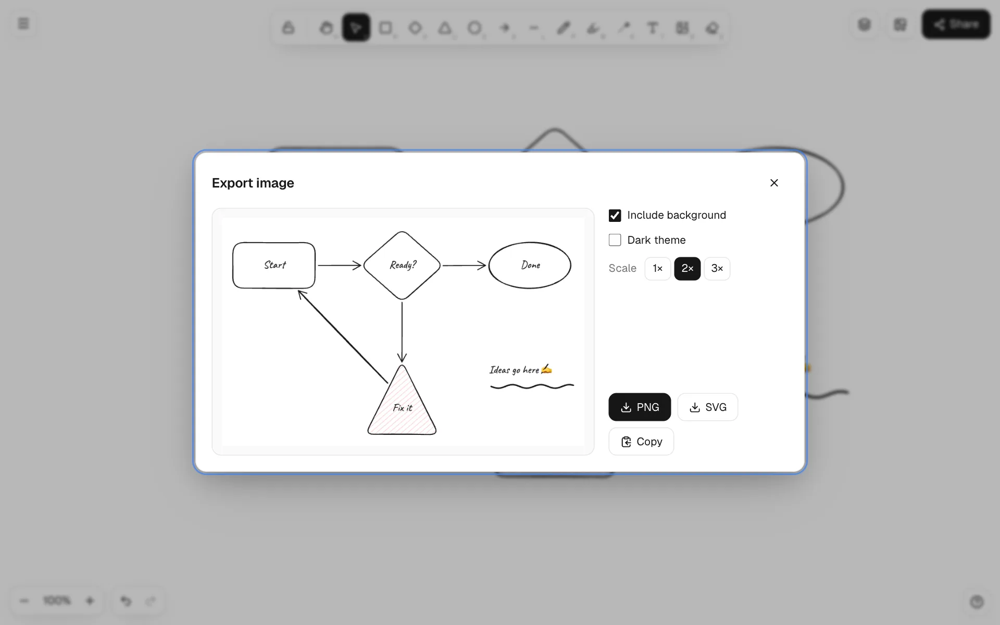

# biyik-draw

**English** · [Türkçe](README.tr.md)

A whiteboard with a hand-drawn look that runs entirely in the browser. The drawing engine and the React UI are written from scratch, with no third-party drawing library. It powers **[draw.biyik.dev](https://draw.biyik.dev)**.



- **Shapes:** rectangle, diamond, triangle, ellipse, arrow, line, pen, text, image, eraser
- **Hand-drawn rendering:** three sloppiness levels, hachure, cross-hatch or solid fill, dashed and dotted strokes
- **Arrows that stick:** drop an arrow end on a shape and it stays bound when the shape moves, resizes or rotates
- **Layers panel:** reorder by dragging, rename, hide, lock, collapsible groups
- **Editing:** multi-select, resize, rotate, flip, align, distribute, copy/paste (including style), undo/redo
- **Export:** PNG, SVG or clipboard; save and open `.biyikdraw` files
- **Built in:** autosave to IndexedDB, dark theme, mobile and touch (pinch to zoom), Turkish and English UI

**[Open the app](https://draw.biyik.dev)** · **[Tutorial with screenshots](https://draw.biyik.dev/docs/en)**

## Install

The package is installed straight from GitHub:

```bash
npm install github:metinfarukbiyik/biyik-draw
# peer dependencies
npm install react react-dom lucide-react
```

## Use it in React

```tsx
import { Draw } from 'biyik-draw/react';
import 'biyik-draw/styles.css';

export default function Whiteboard() {
  return (
    // The board fills its positioned parent
    <div style={{ position: 'relative', height: 640 }}>
      <Draw lang="en" storageKey="my-board" />
    </div>
  );
}
```

For handwriting, load the [Caveat](https://fonts.google.com/specimen/Caveat) font (or `npm i @fontsource/caveat` and `import '@fontsource/caveat'`):

```html
<link rel="stylesheet" href="https://fonts.googleapis.com/css2?family=Caveat:wght@400..700&display=swap" />
```

### Next.js

The board uses canvas and IndexedDB, so render it on the client only:

```tsx
'use client';
import dynamic from 'next/dynamic';

const Whiteboard = dynamic(() => import('./Whiteboard'), { ssr: false });
```

### Props

| Prop | Type | Description |
| --- | --- | --- |
| `lang` | `'tr' \| 'en'` | UI language. Defaults to the browser language and can be changed from the menu. |
| `onLangChange` | `(lang) => void` | Called when the language is changed from the menu. |
| `storageKey` | `string` | IndexedDB key, default `sketch`. Use different keys for several boards on one page. |
| `initialTheme` | `'light' \| 'dark'` | Initial theme. Defaults to the system setting. |
| `onThemeChange` | `(theme) => void` | Called when the theme changes, for example to sync your site theme. |
| `handFont` | `string` | CSS `font-family` for handwriting. Default `'Caveat', cursive`. |
| `brand` | `ReactNode` | Logo on the welcome screen. |
| `links` | `{ label, href, icon? }[]` | Extra links at the bottom of the menu. |
| `docsUrl` | `string` | Shows a Documentation link in the menu. |
| `about` | `AboutInfo` | Shows an About dialog in the menu. |

### Theming

Every color is a CSS variable on `.sk-app`. Override them to match your design:

```css
.sk-app {
  --sk-ink: #0f172a;
  --sk-accent: #6366f1;
  --sk-font: 'Inter', system-ui, sans-serif;
}
```

## Use the engine without the UI

The engine has no dependencies and does not need React:

```ts
import { Editor, exportToSvg, exportToCanvas } from 'biyik-draw';

const editor = new Editor();
editor.load(JSON.parse(fileText)); // a .biyikdraw file

const svg = exportToSvg(editor.elements, editor.files, { background: '#ffffff', theme: 'light', scale: 1 });
const canvas = await exportToCanvas(editor.elements, editor.files, { background: null, theme: 'dark', scale: 2 });
```

`Editor` takes pointer, wheel and keyboard input (`pointerDown`, `pointerMove`, `wheel`, `keyDown`…) and exposes the scene (`elements`, `files`, `state`). `renderScene` draws it on any 2D canvas, so you can build your own UI on top.

## Project layout

```
src/sketch/        engine: model, hand-drawn geometry, hit testing, editor, rendering, export
src/sketch-react/  React UI: toolbar, style panel, layers, dialogs, i18n, styles.css
demo/              Vite playground (npm run dev)
docs/images/       screenshots used in the docs
```

## Develop

```bash
git clone https://github.com/metinfarukbiyik/biyik-draw.git
cd biyik-draw
npm install
npm run dev        # playground at http://localhost:5173
npm run build      # builds dist/
```

## Screenshots

| Style panel | Layers |
| --- | --- |
|  |  |
| **Binding an arrow** | **Export** |
|  |  |

## Privacy

Drawings and images are stored only in the browser (IndexedDB). Nothing is sent to a server.

## License

[MIT](LICENSE) © Metin Faruk Bıyık
