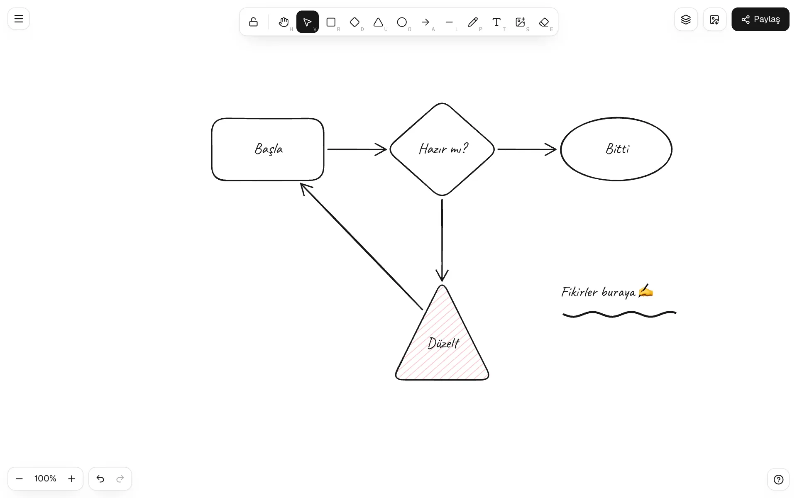
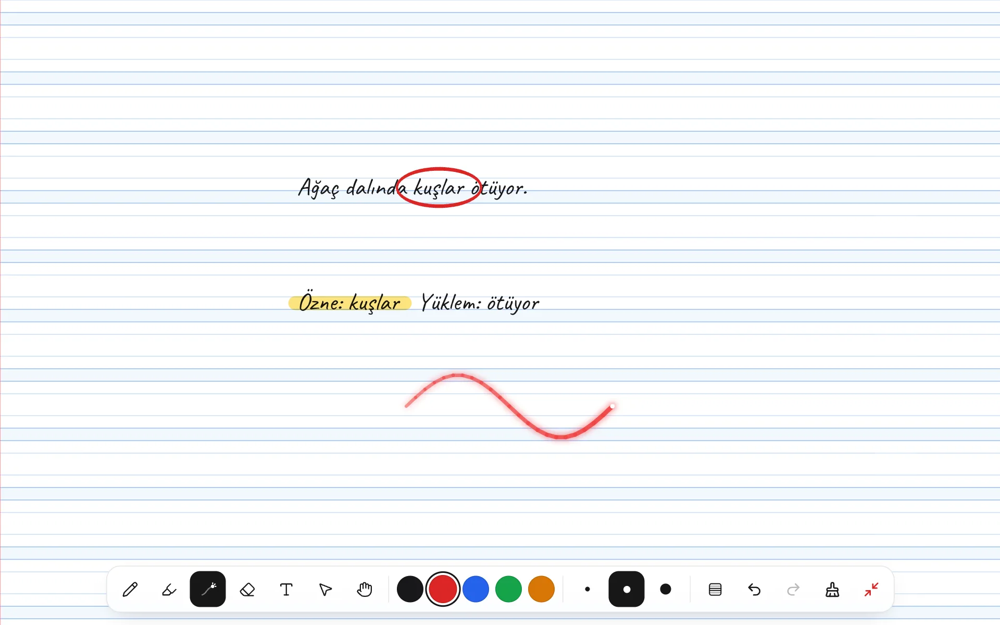
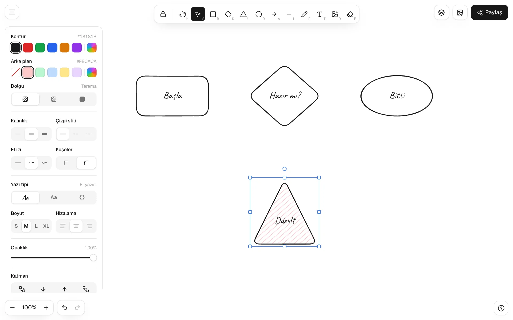
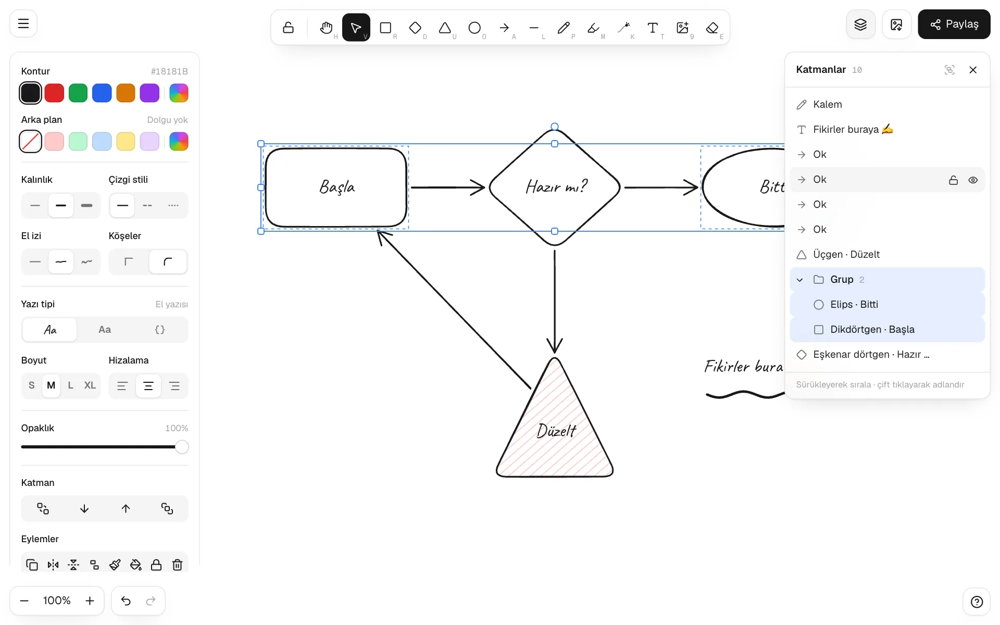
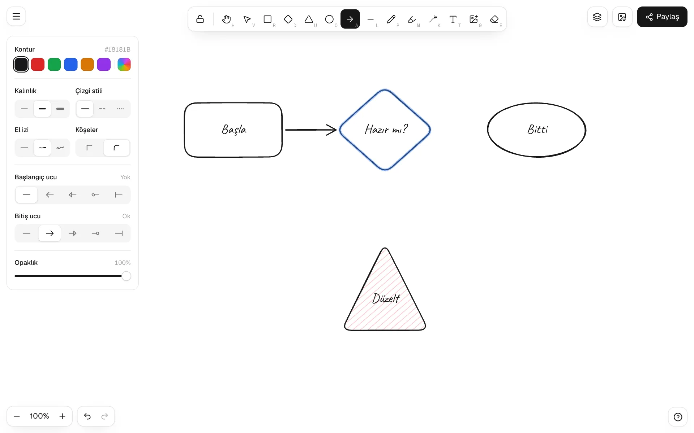
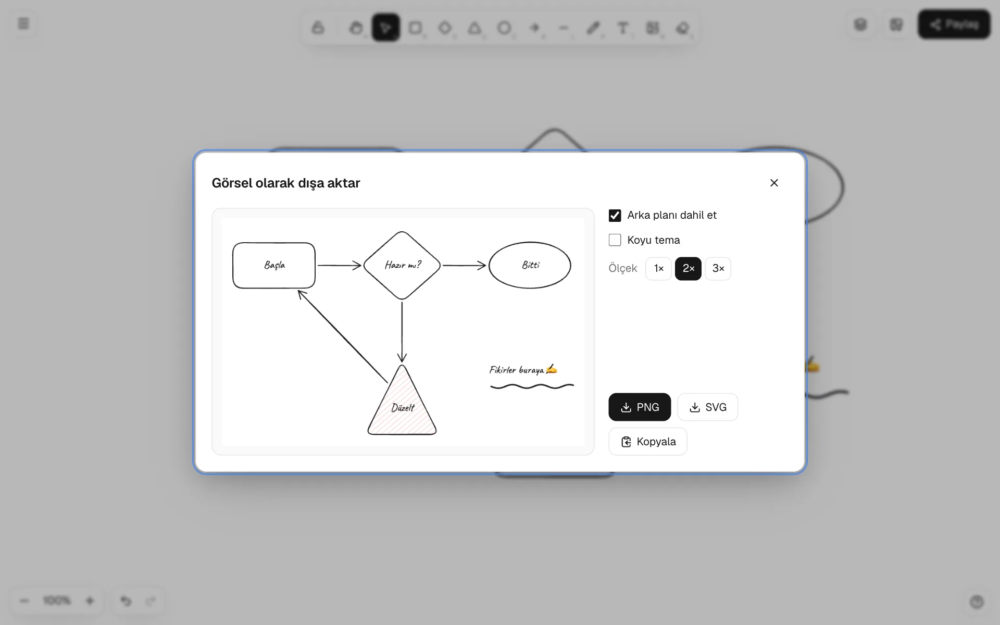

# biyik-draw

[English](README.md) · **Türkçe**

Tamamen tarayıcıda çalışan, el çizimi görünümlü bir beyaz tahta. Çizim motoru ve React arayüzü sıfırdan yazıldı; harici bir çizim kütüphanesi kullanmaz. **[draw.biyik.dev](https://draw.biyik.dev)** bu paketle çalışır.



- **Şekiller:** dikdörtgen, eşkenar dörtgen, üçgen, elips, ok, çizgi, kalem, metin, görsel, silgi
- **El çizimi görünüm:** üç el izi düzeyi; tarama, çapraz tarama ya da tam dolgu; kesik ve noktalı çizgiler
- **Bağlı oklar:** okun ucunu bir şeklin üstüne bırak; şekil taşınsa, büyüse ya da dönse de ok bağlı kalır
- **Katmanlar paneli:** sürükleyerek sıralama, adlandırma, gizleme, kilitleme, açılıp kapanan gruplar
- **Düzenleme:** çoklu seçim, boyutlandırma, döndürme, çevirme, hizalama, eşit dağıtma, kopyala/yapıştır (stil dahil), geri al/yinele
- **Sağ tık menüsü:** sağ tık ya da dokunmatikte basılı tutma: panoya PNG/SVG/metin, metni şekle bağlama, metni kutu içine alma, çerçeveye alma, katman sırası ve fazlası
- **Öğretmenler ve tablet için:** ders modu (tam ekran, büyük düğmeler), kareli, noktalı, çizgili ve kılavuz çizgili (güzel yazı) kâğıt, fosforlu kalem, lazer işaretçi, kalem basıncı ve avuç içi koruması
- **Paylaşma:** çizimin kendisini taşıyan bağlantı (hiçbir şey yüklenmez), “Tahtama ekle”li salt okunur görünüm ve çevrimdışı HTML dosyası
- **Dışa aktarma:** PNG, SVG (yazı tipleri gömülü) ya da pano; `.biyikdraw` dosyası olarak kaydetme ve açma
- **Hazır gelenler:** IndexedDB'ye otomatik kayıt, koyu tema, mobil ve dokunmatik (iki parmakla yakınlaştırma), Türkçe ve İngilizce arayüz

**[Uygulamayı aç](https://draw.biyik.dev)** · **[Ekran görüntülü eğitim](https://draw.biyik.dev/docs)**

## Kurulum

Paket doğrudan GitHub'dan kurulur:

```bash
npm install github:metinfarukbiyik/biyik-draw
# eş bağımlılıklar
npm install react react-dom lucide-react
```

## React'te kullanım

```tsx
import { Draw } from 'biyik-draw/react';
import 'biyik-draw/styles.css';

export default function Tahta() {
  return (
    // Tahta, konumlandırılmış üst öğesini doldurur
    <div style={{ position: 'relative', height: 640 }}>
      <Draw lang="tr" storageKey="benim-tahtam" />
    </div>
  );
}
```

El yazısı için [Caveat](https://fonts.google.com/specimen/Caveat) yazı tipini yükle (ya da `npm i @fontsource/caveat` ve `import '@fontsource/caveat'`):

```html
<link rel="stylesheet" href="https://fonts.googleapis.com/css2?family=Caveat:wght@400..700&display=swap" />
```

### Next.js

Tahta tuval ve IndexedDB kullandığı için yalnızca tarayıcıda yüklenmelidir:

```tsx
'use client';
import dynamic from 'next/dynamic';

const Tahta = dynamic(() => import('./Tahta'), { ssr: false });
```

### Özellikler (props)

| Prop | Tür | Açıklama |
| --- | --- | --- |
| `lang` | `'tr' \| 'en'` | Arayüz dili. Verilmezse tarayıcı dili kullanılır; menüden değiştirilebilir. |
| `onLangChange` | `(lang) => void` | Menüden dil değişince çağrılır. |
| `storageKey` | `string` | IndexedDB anahtarı, varsayılan `sketch`. Aynı sayfada birden çok tahta için farklı verin. |
| `initialTheme` | `'light' \| 'dark'` | Başlangıç teması. Verilmezse sistem ayarı. |
| `onThemeChange` | `(theme) => void` | Tema değişince çağrılır (ör. sitenin temasını eşitlemek için). |
| `handFont` | `string` | El yazısı için CSS `font-family`. Varsayılan `'Caveat', cursive`. |
| `brand` | `ReactNode` | Karşılama ekranındaki logo. |
| `links` | `{ label, href, icon? }[]` | Menünün altındaki ek bağlantılar. |
| `docsUrl` | `string` | Menüde Dokümantasyon bağlantısı gösterir. |
| `about` | `AboutInfo` | Menüde Hakkında penceresi gösterir. |
| `onEvent` | `(name, params?) => void` | Analytics için kullanım olayları: `share_open`, `export_open`, `teaching_mode`, `shared_view`, `shared_added`, `file_save`… |

### Görünümü özelleştirme

Tüm renkler `.sk-app` üzerindeki CSS değişkenleridir:

```css
.sk-app {
  --sk-ink: #0f172a;
  --sk-accent: #6366f1;
  --sk-font: 'Inter', system-ui, sans-serif;
}
```

## Öğretmenler ve tablet için

Tabletten ders anlatıp projeksiyona ya da akıllı tahtaya yansıtmak için:

- **Ders modu** (`⌥P`): tam ekran; kalem, fosforlu kalem, lazer, silgi, renkler, kalınlık, kâğıt, geri al ve yeni sayfa için büyük dokunma düğmeleri.
- **Kâğıt desenleri:** kareli, noktalı, çizgili ve kılavuz çizgili (dört çizgili güzel yazı). Kodla: `editor.setPaper('guide')`.
- **Fosforlu kalem** (`M`) ve **lazer işaretçi** (`K`).
- **Kalem basıncı** ve **avuç içi koruması:** kalem algılanınca dokunmatik yalnızca kaydırır ve yakınlaştırır (`editor.setPenOnly(false)` ile kapatılır).



## Paylaşma ve çevrimdışı

**Paylaş** düğmesi çizimin kendisini taşıyan bir bağlantı üretir: çizim sıkıştırılıp adresin `#` kısmına yazılır. Bu kısım sunucuya hiç gönderilmez, yani hiçbir şey yüklenmez. Bağlantıyı açan kişi çizimi salt okunur görür ve **Tahtama ekle** ile kendi tahtasına kopyalayabilir.

Aynı pencereden **çevrimdışı HTML dosyası** indirilir: çizimin SVG'sini, gömülü yazı tiplerini ve sahne verisini içeren tek bir dosya. İnternet olmadan her tarayıcıda açılır, **Aç** ile yeniden düzenlenebilir.

Yardımcı işlevler de dışa açıktır:

```ts
import { encodeShare, decodeShare, buildOfflineHtml } from 'biyik-draw/react';

const parca = await encodeShare({ elements, files, background: '#ffffff' });
const adres = `${location.origin}/#${parca}`;
const sahne = await decodeShare(location.hash); // geçersizse null
```

Uygulamanın internetsiz açılması için sayfayı ve dosyalarını önbelleğe alan bir service worker kaydet. draw.biyik.dev'in kullandığı [şu dosya](https://github.com/metinfarukbiyik/metinfarukbiyik/blob/main/public/draw-sw.js) örnek olabilir.

## Arayüz olmadan motoru kullanma

Motorun bağımlılığı yoktur ve React gerektirmez:

```ts
import { Editor, exportToSvg, exportToCanvas } from 'biyik-draw';

const editor = new Editor();
editor.load(JSON.parse(dosyaMetni)); // .biyikdraw dosyası

const svg = exportToSvg(editor.elements, editor.files, { background: '#ffffff', theme: 'light', scale: 1 });
const canvas = await exportToCanvas(editor.elements, editor.files, { background: null, theme: 'dark', scale: 2 });
```

`Editor` işaretçi, tekerlek ve klavye olaylarını alır (`pointerDown`, `pointerMove`, `wheel`, `keyDown`…) ve sahneyi (`elements`, `files`, `state`) sunar. `renderScene` sahneyi herhangi bir 2B tuvale çizer; üzerine kendi arayüzünü kurabilirsin.

## Klasör yapısı

```
src/sketch/        motor: model, el çizimi geometri, isabet testi, düzenleyici, çizim, dışa aktarma
src/sketch-react/  React arayüzü: araç çubuğu, stil paneli, katmanlar, pencereler, dil, styles.css
demo/              Vite deneme alanı (npm run dev)
docs/images/       dokümandaki ekran görüntüleri
```

## Geliştirme

```bash
git clone https://github.com/metinfarukbiyik/biyik-draw.git
cd biyik-draw
npm install
npm run dev        # http://localhost:5173 adresinde deneme alanı
npm run build      # dist/ klasörünü üretir
```

## Ekran görüntüleri

| Stil paneli | Katmanlar |
| --- | --- |
|  |  |
| **Oku şekle bağlama** | **Dışa aktarma** |
|  |  |

## Gizlilik

Çizimler ve görseller yalnızca tarayıcıda (IndexedDB) saklanır. Sunucuya hiçbir şey gönderilmez.

## Lisans

[MIT](LICENSE) © Metin Faruk Bıyık
